# PawCare data model

The versioned schema lives in `supabase/migrations`. `202610160001_identity_shell.sql` contains identity and app-shell tables; `202610160002_pawcare_domains.sql` adds passport, booking, SOS, care plans, AI audit, clinic finance, and commerce; `202610160003_community_rescue.sql` adds community and rescue records; `202610160004_community_privacy_hardening.sql` adds moderation review, image exposure gates and sparse-count suppression; `202610160005_billing_sandbox.sql` adds owner plans, subscriptions, payments, receipts, and reconciliation.

```mermaid
erDiagram
  PROFILES ||--o{ PET_OWNERS : shares
  PETS ||--o{ PET_OWNERS : has
  PETS ||--o{ PET_ALLERGIES : reports
  PETS ||--o{ PET_CONDITIONS : has
  MEDICATION_CATALOG ||--o{ CONTRAINDICATION_RULES : checks
  PET_CONDITIONS ||--o{ CONTRAINDICATION_RULES : matches
  PETS ||--o{ MEDICAL_RECORDS : timeline
  MEDICAL_RECORDS ||--o| VACCINATIONS : details
  MEDICAL_RECORDS ||--o| PRESCRIPTIONS : details
  PETS ||--o{ RECORD_ACCESS_GRANTS : consents
  CLINICS ||--o{ RECORD_ACCESS_GRANTS : receives
  CLINICS ||--o{ CLINIC_STAFF : employs
  CLINICS ||--o{ CLINIC_SERVICES : offers
  CLINICS ||--o{ AVAILABILITY_SLOTS : publishes
  PETS ||--o{ APPOINTMENTS : books
  AVAILABILITY_SLOTS ||--o{ APPOINTMENTS : reserves
  APPOINTMENTS ||--o| REVIEWS : enables
  PETS ||--o{ SOS_REQUESTS : needs
  SOS_REQUESTS ||--o{ SOS_DISPATCHES : pings
  SOS_REQUESTS ||--o| TRIAGE_SESSIONS : starts
  TRIAGE_SESSIONS ||--o{ MESSAGES : contains
  PETS ||--o{ CARE_PLANS : receives
  CARE_PLANS ||--o{ CARE_PLAN_ITEMS : includes
  PROFILES ||--o{ AI_RUNS : invokes
  PRODUCTS ||--o{ AFFILIATE_LINKS : links
  AFFILIATE_LINKS ||--o{ AFFILIATE_CLICKS : tracks
  CLINICS ||--o{ COMMISSION_LEDGER : accrues
  CLINICS ||--o{ INVOICES : billed
  PROFILES ||--o{ AUDIT_LOGS : acts
  PETS ||--o{ AUDIT_LOGS : audited
  PROFILES ||--o{ COMMUNITY_POSTS : authors
  COMMUNITY_POSTS ||--o{ COMMUNITY_COMMENTS : contains
  PROFILES ||--o{ LOST_FOUND_REPORTS : reports
  PROFILES ||--o{ STRAY_REPORTS : reports
  RESCUE_PARTNERS ||--o{ RESCUE_CASES : verifies
  CLINICS ||--o{ RESCUE_CASES : verifies
  RESCUE_CASES ||--o{ RESCUE_ESTIMATES : estimates
  RESCUE_CASES ||--o{ DONATION_LEDGER : records
  DONATION_LEDGER ||--o{ RESCUE_LEDGER_EVENTS : audits
  PROFILES ||--o{ BILLING_SUBSCRIPTIONS : subscribes
  BILLING_PLANS ||--o{ BILLING_SUBSCRIPTIONS : selects
  BILLING_SUBSCRIPTIONS ||--o{ BILLING_PAYMENTS : receives
  BILLING_PAYMENTS ||--o{ BILLING_WEBHOOK_EVENTS : reconciles
  BILLING_SUBSCRIPTIONS ||--o{ BILLING_DOCUMENTS : documents
  BILLING_PAYMENTS ||--o{ BILLING_DOCUMENTS : receipts
  BILLING_PAYMENTS ||--o| BILLING_RECONCILIATION_JOBS : retries
  PROFILES ||--o| NOTIFICATION_PREFERENCES : configures
  PROFILES ||--o{ NOTIFICATIONS : receives
  NOTIFICATIONS ||--o| NOTIFICATION_JOBS : queues
  NOTIFICATIONS ||--o{ NOTIFICATION_DELIVERIES : attempts
  PROFILES ||--o{ WEB_PUSH_SUBSCRIPTIONS : subscribes
  PROFILES ||--o{ FEATURE_FLAGS : changes
  PROFILES ||--o{ COMMUNITY_MODERATION_REPORTS : flags
  PROFILES ||--o{ COMMUNITY_APPEALS : appeals
```

## Authorization and invariants

- Every table has RLS. Owners and accepted co-owners use `owns_pet`; clinic reads of pet data require a live, unrevoked, scoped `record_access_grants` row.
- `book_slot` locks and reserves a slot in a transaction and is idempotent per owner key. `accept_sos` uses a conditional state transition so only one clinic can win.
- Review inserts are checked against completed appointments and `appointment_id` is unique. Clinical records and financial ledger rows are append-only; corrections use amendments or reversals. Audit logs reject update/delete.
- Geography columns use PostGIS `geography(Point,4326)` and GIST indexes. `find_sos_clinics` uses `ST_DWithin` and distance ordering.
- `record_vaccination` writes the record, exact vaccine fields, and owner-visible audit event transactionally after verifying clinic membership and active vaccination scope.
- Contraindication rules require an active row and review timestamp; demo rules are explicitly marked and excluded from production reads/evaluation.
- SOS/care-plan demo rule rows are disabled and marked `is_demo`; fictional commerce/catalog fixtures are also marked demo. Demo rows are not surfaced by production read policies.

## Community and rescue

- `lost_found_reports` and `stray_reports` keep `exact_location` private under owner/moderator RLS. A write trigger derives `public_location` by snapping to a 50m Web Mercator grid; public map RPCs return only that rounded point. Public stray neighborhood counts aggregate to a 250m grid and suppress groups with fewer than three reports.
- Lost/found matches are suggestions: same species, opposite report kind, within 10km; matching color tags add ranking weight before distance. Only the report owner can confirm a suggestion. Confirmation resolves that report and marks the other report matched; its owner can then confirm the same pair to resolve their report too.
- Posts, comments, reports, rescue cases and uploaded images start pending. A platform moderator reviews image and content safety together; only approved, safe images may receive a short-lived signed URL. Storage stays private and receipt/estimate documents are never included in public image RPCs.
- Rescue partners submit verification evidence. Cases require an already verified clinic/partner, a vet-submitted treatment estimate with a private supporting document, and partner verification before they appear publicly. Donors confirm they paid directly and upload a receipt; the named clinic/partner verifies it before the public aggregate ledger changes. PawCare has no payment or custody table.
- `donation_ledger` permits only pending-to-verified/rejected status transitions; event rows are append-only. Donor aliases and receipt paths are excluded from public ledger RPCs.
- `community_moderation_reports` and `community_appeals` are separate queues. An accepted appeal resets content to pending, requiring fresh moderation before republication.

## Billing lifecycle

- `billing_plans` is admin-managed and read-only to signed-in users. Seed prices are fictional demo configuration, not an offer. Clinic `invoices` and `commission_ledger` remain separate records.
- `billing_subscriptions` stores the current plan and time boundaries. `modules/billing/entitlements.ts` is the central feature-access function; basic SOS and clinic dispatch remain enabled in every plan.
- `billing_payments.external_reference` and `idempotency_key` are unique. An authenticated server route creates local sandbox attempts; the app never calls a live provider.
- The webhook route validates HMAC and Zod before calling the locked `apply_sandbox_payment_event` RPC. Event uniqueness and payment row locking make webhook replays and concurrent delivery idempotent.
- `billing_documents` contains sandbox receipts/statements only. They are explicitly not tax invoices. Clinic statements are generated from their commission ledger.
- RLS is enabled on all billing tables. Owners can read only their own subscription, payment and document rows. Only server service-role code mutates payment state; its key is server-only.
- A scheduled authenticated POST to `/api/internal/billing/reconcile` uses `BILLING_JOB_TOKEN`. Local mock checks pending events with backoff and expires abandoned attempts after 24 hours. Live provider status lookups/retries are unavailable until a provider adapter is separately verified.

## Notifications and platform administration

- `notification_preferences` stores category/channel choices, quiet-hour window and timezone, plus durable email/SMS suppression timestamps. Owners can read and update only their row. Urgent SOS bypasses quiet hours but still honors disabled channels/categories and unsubscribe suppression.
- `notifications.idempotency_key` deduplicates domain events. An insert trigger creates one `notification_jobs` row; a service-only `claim_notification_jobs` RPC claims due work with `FOR UPDATE SKIP LOCKED`, ordering high-priority SOS first. `notification_deliveries` records per-channel provider outcome and attempt without storing message content or push endpoints.
- Domain triggers enqueue appointment reminders, vaccination due reminders, approved care-plan tasks, post-visit review requests, and SOS clinic/owner updates. The internal processor at `/api/internal/notifications/process` requires `NOTIFICATION_JOB_TOKEN`; schedule it with the deployment job runner. Retries use bounded exponential delay and stop after five attempts.
- `web_push_subscriptions` is owner-managed and RLS protected. Push endpoints are private capabilities; only configured push service hosts are accepted. `feature_flags` and `ai_eval_runs` are platform-admin readable. Admin mutations and sensitive moderation updates require AAL2 in both server routes and database triggers. Database triggers append audit rows for admin changes; the audit log remains append-only.
- `profiles.suspended_at` blocks suspended accounts in server authorization checks. Admin verification decisions persist checklist, reviewer, reason and timestamp. Service-role worker credentials and provider keys are server-only.

## Test and apply

Use `supabase db reset` to apply migrations locally and seed fixtures, then `supabase test db` for `supabase/tests/domain_security.test.sql`. This workspace has no configured Supabase project credentials, so migrations and RLS tests have not been executed against a live database.
